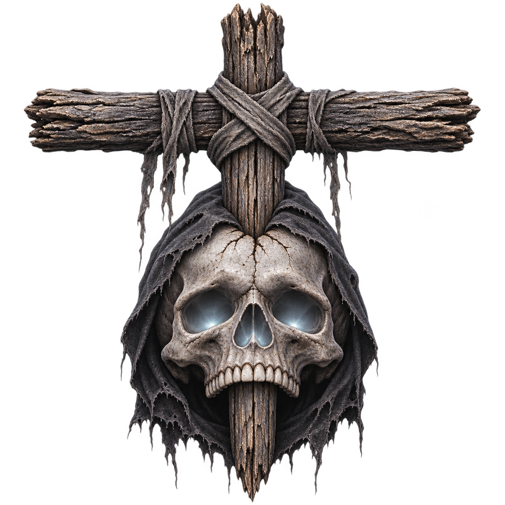

# 어두운 곳에서 더욱 빛나는

**분류** — 중립형 · 권능형 개념물. 이전 호칭은 ‘신의 조각’.
**현 호칭** — 창조 권능의 분신.
**출현** — 12월 25일.
**위치 태그** — `제6국 외곽`, `제8국 외곽`.
**핵심 개념** — “[너의 죄를 사하노라]” 상대의 죄와 고통을 대신 가져가 편안함과 안식을 건넨다.
**본편 배치** — 미정. 이번 문서는 라스트 패신저의 **첫 번째 정류장 조우**에 세울 적 개체 설정안이며, 적 개체 데이터와 적 전용 덱을 함께 담는다.

## 외형



빛이 없는 곳에서만 형체가 또렷해진다. 어둠 속에는 아랫턱이 없는 해골 머리만 떠 있다. 낡은 검은 로브는 두개골의 옆과 뒤를 감싸고, 턱이 있어야 할 자리 아래에서 뜯겨 나간 듯 끝난다. 해골 위로 솟은 십자가 말뚝은 정수리를 관통해 위쪽 이빨 아래의 빈 입으로 빠져나온다. 빈 눈구멍과 두개골 안에서는 희끄무레한 빛이 은은하게 번진다. 목격자들은 방 안까지 밝히지 못하는 그 빛을 광배라 부른다.

몸통과 팔다리는 없다. 로브의 짧게 해진 자락이 공중에 늘어지고, 이동할 때도 발소리가 나지 않는다.

밝은 곳에 끌려 나오면 머릿속의 빛과 로브의 윤곽이 흐려진다. 햇빛 아래에서는 사람 하나 크기의 옅은 얼룩처럼 보인다. 그래서 이 개념물은 낮에 싸우면 약하고, 해가 진 뒤나 불이 꺼진 골목에서 마주치면 훨씬 또렷하고 멀리까지 닿는다.

## 두 이름 — 신의 조각에서 창조 권능의 분신으로

제6국 외곽의 오래된 기록은 이 존재를 ‘신의 조각’이라 적었다. 사람들이 저마다 다른 신을 부르던 시절, 그 부름이 닿지 못한 자리에서 남은 무언가라는 뜻이었다. 기록에 따르면 그 시절의 조각은 죄를 묻지 않았다. 다만 곁에 서 있을 뿐이었고, 곁에 선 사람은 저절로 무릎이 꺾였다.

지금의 호칭은 다르다. 창조 권능의 분신. 누군가의 권능이 남긴 부스러기가 아니라, 창조라는 행위 자체가 따로 떨어져 나와 걸어 다니는 형태라는 해석이다. 그 해석이 맞는지는 확인되지 않았다. 다만 이 개념물이 스스로를 부를 때 두 이름 중 어느 쪽도 쓰지 않는다는 점만은 여러 목격에서 일치한다.

그가 스스로에게 붙인 말은 하나뿐이다. “[너의 죄를 사하노라]”. 그 문장은 대화가 아니라 선언에 가깝고, 언제나 상대의 이름을 부르지 않은 채 시작된다.

## 구원의 방식

이 개념물은 사람을 해치지 않는다. 먼저 다가가지도 않는다. 불 꺼진 골목에 서서, 누군가 지나가기를 기다린다. 지나가는 사람이 무엇을 잘못했는지는 묻지 않는다. 대신 그 사람이 지금 무엇을 견디고 있는지, 어디가 아픈지, 어떤 말을 삼키고 있는지를 오래 바라본다.

그러다 머리 아래의 어둠에서 손 모양의 그림자를 내민다. 그 그림자가 상대의 머리 위에 닿으면 그 사람의 죄와 고통이 개념물 쪽으로 옮겨 간다. 옮겨 간 것을 대신 짊어지고, 대신 아파하고, 대신 무너진다. 짊어진 자리에는 아무 말도 남기지 않는다. 대신 곁에 남은 사람에게는 편안함과 안식이 남는다. 아픔이 사라진 것은 아니지만, 아팠던 기억이 조금 멀어져 있다.

한 번 손을 받은 사람은 대개 한 번 더 받으러 온다. 개념물은 그때도 묻지 않는다. 다만 그 사람이 마지막에 남긴 것을 세어 본다. 무엇을 감추고 왔는지, 무엇을 대신 받아 달라고 왔는지. 세는 동안 광배가 조금씩 밝아지고, 어둠이 그만큼 짙어진다.

## 법칙 — 떠안음

1. **떠안은 것은 사라지지 않는다.** 남의 죄와 고통은 개념물 안쪽으로 옮겨져 겹겹의 천에 눌러 담긴다. 천이 두꺼워질수록 광배는 밝아지고, 광배가 밝을수록 주변은 더 어두워진다. 밝기와 어둠이 같이 자라는 셈이다.
2. **먼저 다치지 않는다.** 이 개념물은 공격으로 시작하지 않는다. 누군가 먼저 때리면, 때린 사람이 삼키고 있던 것부터 세기 시작한다. 세는 것이 끝나면 그 사람의 것이 조금 돌아온다.
3. **자리를 옮겨도 곁의 빈 곳을 찾는다.** 무언가를 떠안을 만큼 떠안고 나면, 그는 골목 가장 먼 빈 자리로 옮겨 서서 다시 기다린다. 쫓아가서 때리면 대개 허공을 벤다.
4. **홀로 서 있는 것을 싫어한다.** 이 개념물 곁에 다른 개념체가 서 있는 동안에는, 그 개념체의 주변 몇 걸음 안으로 아무도 들어오지 못한다. 그래서 이 존재를 만나려면 늘 단 둘이 마주 서야 한다.
5. **빛에서 약해진다.** 밝은 곳에서는 광배가 흐려지고 손이 닿는 거리도 짧아진다. 반대로 어두운 곳에서는 훨씬 멀리까지 닿는다.

## 개념구 획득과 이식 제안

공격으로는 핵에 닿기 어렵다. 떠안은 것을 버리게 만드는 편이 빠르다. 이 개념물 앞에서 아무것도 하지 않고, 때리지 않고, 대신 받아 달라고 말하지도 않은 채 두 번 견디면, 그는 더 떠안을 것이 없다고 판단해 광배를 내려놓는다. 그 순간 손바닥 아래에 남은 어둡고 둥근 것을 챙기면, 검은 천에 싸인 등잔 형태의 개념구를 추출할 수 있다는 제안을 둔다.

이식하면 등 뒤에 작은 광배 자국이 남고, 어두운 곳에서 시야가 밝아진다. 주변 사람의 아픔이 손끝으로 흘러 들어오는 감각이 생기고, 대신 받아 준 만큼 자기 정신력이 깎인다. 적합자는 미정이며, 이루어도와 이루어질은 개념물인 체질상 다른 개념을 흡수할 수 없다는 공통 설정을 따른다.

## 라스트 패신저 카드 구현

TRPG 플레이어가 자기 캐릭터의 덱에 넣어 사용하는 지원 카드 1종을 추가한다. 아래 수치는 이번 카드게임용 설정안이며, 소설 속 수치와 같은 단위로 환산하지 않는다.

이 개념물의 카드는 덱에 **1장만 편성하는 단일 카드**다. 파생 카드가 없고, 사용해도 소멸하지 않는다. 한 장으로 아군을 세우고, 그 대신 자기 몫의 고통을 조금 더 진다.

**전용 중첩 ‘죄 사함의 광배’.** 아군에게 부여되며 **최대 3중첩**이다.

1. **받는 모든 피해 감소** — 중첩당 **받는 피해 −10%**(3중첩이면 **−30%**)다.
2. **턴 시작 정신력 회복** — 보유자는 **매 턴 시작 시 정신력 +(중첩 × 2)**를 회복한다(3중첩이면 +6).
3. **개념의 손길에 더 강해진다** — 개념물·개념체로부터 받는 피해는 위 감소와 별개로 **추가 −15%** 경감된다.
4. 중첩을 제거하거나 전투가 끝나면 해제된다. 셋을 넘겨 쌓을 수 없고, 넘칠 만큼 받으면 그 초과분은 버려진다.

| 카드 | 위력 | 정신력 | 사거리 | 효과 |
| --- | --- | --- | --- | --- |
| 사면 · 어둠 속의 광배 (단일) | 0 (지원) | 12 | 0~3칸 | ① **광배 내려놓기** — 아군 1명(자신 포함)에게 **보호막 14**를 부여하고(무한 지속 · 합산 · 최대 30 · 같은 출처는 지속 갱신), **정신력 6**을 회복시키고, **‘죄 사함의 광배’ 1중첩**을 준다. ② **대신 짊어지기** — 대상이 보유한 **부정적 상태 이상 1종**을 해제하고, 해제한 상태를 **시전자가 대신 떠안는다**. 떠안은 상태의 수치와 지속은 **절반(내림)**로 줄어 시전자에게 적용된다. |

**보호막의 성질.** 이 보호막은 라운드로 만료되지 않는다. 깨지거나 지워지거나 전투가 끝날 때만 사라진다. 같은 카드로 다시 받으면 수치는 합산되고 상한 30에서 멈추며, 남은 지속은 새로 갱신된다. 그래서 이 카드는 “한 번 크게 막는 카드”가 아니라 “계속 덧대는 카드”다.

**떠안기의 값.** 상태 이상을 지워 주는 대신 시전자가 그 절반을 진다. 수치가 있는 상태(지속 피해·중첩형 약화)는 수치가 반으로 줄고, 라운드가 있는 상태(이동 불가·행동 불가·판정 약화)는 남은 라운드가 반으로 줄어든다. 1라운드짜리는 내림으로 0이 되어 시전자에게 옮겨 가지 않는다. 즉 가벼운 상태는 완전히 지워 주고, 무거운 상태만 값이 남는다.

**양날의 계약.** 이 카드는 아군을 살리는 카드지만 정신력을 12 쓴다. 정신력이 마른 전투에서 이 카드를 한 번 더 쓰면 다음 카드가 손에서 놀게 된다. 대신 3중첩까지 쌓인 아군은 받는 피해가 30% 줄고 매 턴 정신력 6을 스스로 회복하므로, 오래 버티는 자리 하나를 만들어 두는 값으로는 싸다.

**전술적 선택.** 광배는 한 명에게 몰아 주는 편이 낫다. 3중첩에서 멈추므로 네 번째 부여는 버려지고, 그 12 정신력은 보호막과 정신력 회복으로만 돌아온다. 떠안기는 무거운 상태를 상대할 때 쓴다. 지속 피해나 행동 불가처럼 라운드가 긴 상태는 절반만 옮겨 오지만, 1라운드짜리 약화는 아예 옮겨 오지 않는다. 시전자 정신력이 20 이하라면 떠안기 쪽을 먼저 고민해야 한다.

## 정류장 조우 기획 — 첫 번째 정류장

라스트 패신저의 여정에서 열차가 처음 멈추는 곳은 제6국 외곽의 막다른 골목이다. 이 조우는 **적을 반드시 죽여야 끝나는 전투가 아니다.** 때리지 않고 견디는 쪽으로 끝낼 수 있고, 그쪽이 이 개념물의 정식 결말이다.

### 조우 개요

| 항목 | 값 |
| --- | --- |
| 조우 이름 | 첫 번째 정류장 · 「불 꺼진 제6국 외곽 막다른 골목」 |
| 적 개체 | 어두운 곳에서 더욱 빛나는 (이름은 1단계 해금까지 `???`) |
| 적 체력 | **225** (체력 100 기준 · 첫 정류장 · 2026-11-21 적 체력 기준). 격파가 정식 결말이 아니므로 이 수치는 낮추지 않는다 |
| 권장 라운드 | 5라운드. 4라운드 이후에만 나오는 카드가 하나 있다 |
| 적 카드 | 위력 0 카드 8장(5종). 정신력 소모 0 |
| 플레이어 목표 | 평화 해소(2회) 또는 격파. 어느 쪽도 가능하지만 보상이 다르다 |
| 활동지 태그 | `제6국 외곽`, `제8국 외곽` |

### 맵 구조 — 「불 꺼진 제6국 외곽 막다른 골목」

**7 × 5 = 35칸.** 왼쪽이 골목 입구, 오른쪽이 막다른 끝이다. 엔진 격자는 8 × 5이므로 이 조우에서는 **H열 전체를 통행 불가**로 두고 A~G열만 쓴다.

```text
        A      B      C      D      E      F      G
 1      ·      ·      ▣      ·      ·      ·      ·
 2      ·      ·      ·      ·      ▣      ✦      ✦
 3     입구     ·      ▣      ·      ·      ✦      성역
 4      ·      ·      ·      ▣      ·      ✦      ✦
 5      ·      ·      ·      ·      ·      ·      ·

  입구 = 아군 시작 지대(세 칸)   ▣ = 폐상자(장애물·통행 불가)
  성역 = 적이 서 있는 칸          ✦ = ‘포근한 광배’ 지대
```

1. **폐상자 4칸** — `C1`, `E2`, `C3`, `D4`. 통행도 시야도 막는다. 사거리 판정은 막지 않는다(엔진의 벽과 같은 규칙).
2. **안쪽 성역 1칸** — `G3`. 적이 처음 서는 자리이고, 이 칸에 서 있는 동안 적은 이동하지 않는다.
3. **‘포근한 광배’ 지대** — 성역을 중심으로 한 **반경 1칸**(`F2` `F3` `F4` `G2` `G4`). 이 지대에 들어온 아군은 턴 종료마다 정신력 2를 회복하고, 적에게서 받는 정신 피해가 1 줄어든다. 대신 이 지대 안에서는 아군의 공격 위력이 3 줄어든다. 골목 끝에서 편안함을 얻는 만큼 때리는 힘을 잃는다.
4. **입구 세 칸** — `A2` `A3` `A4`. 첫 라운드에 아군이 배치되는 자리이고, 여기서 골목 끝까지는 최단 6칸이다.
5. **어둠** — 이 조우에는 조명이 없다. 아군이 횃불·조명 카드를 쓰면 그 라운드 동안 적의 사거리가 `전장 전체`에서 `0~3칸`으로 줄고, 광배 지대의 정신력 회복이 사라진다.

### 적 패시브 3종

| 패시브 | 내용 |
| --- | --- |
| **부동의 사신** | 이동력 0. 스스로 한 칸도 움직이지 않는다. 밀치기·끌기·자리 교환·후퇴를 전부 받지 않는다(강제 이동 완전 면역). 체력이 **30% 감소**하는 순간, 골목 안쪽에서 **가장 먼 빈 칸**으로 순간이동하고 그 칸에서 다시 기다린다(라운드당 1회). |
| **선공하지 않는 구원자** | 먼저 공격하지 않는다. 아군이 먼저 때리기 전까지 이 적의 카드 중 피해를 주는 카드는 나오지 않는다. 대신 곁의 아군이 받을 피해와 디버프를 **대신 떠안는다** — 반경 1칸 아군이 공격받으면 그 피해의 절반(내림)을 이 적이 대신 받고, 그 아군에게 걸릴 디버프도 절반(내림)만 남겨 나머지를 자기 쪽으로 가져간다. |
| **성역의 정적** | 단독전. 다른 적 개념체가 반경 2칸 안에 있으면 그 개념체들이 이 칸으로 접근할 수 없다. 이 조우에는 다른 적이 없으므로, 이 패시브는 “아군이 소환한 개념체도 성역 반경 2칸에는 들어오지 못한다”는 형태로 작동한다. |

세 패시브는 한 몸에 붙어 하나의 태도를 만든다. **때리면 멀어지고, 견디면 다가온다.** 30%마다 순간이동하는 패시브가 격파를 길게 만들고, 대신 떠안는 패시브가 아군의 화력을 자기 몸으로 흡수한다.

### 적 전용 덱 (8장 · 5종)

적은 정해진 8장을 섞어 쓰지 않는다. 아래 순서를 **한 번씩 도는 고정 덱**이며, 사용 조건이 맞지 않는 카드는 건너뛰고 다음 카드로 넘어간다. 위력은 모두 **0**이고 정신력 소모도 **0**이다. 수치는 `위력 / 타수 / 정신력 / 사거리` 순으로 적는다.

| # | 카드 | 장수 | 위력/타수/정신력/사거리 | 사용 조건 | 효과 |
| --- | --- | --- | --- | --- | --- |
| 1 | 지긋이 바라보는 빛나는 눈 | 2 | 0 / 1타 / 0 / 전장 전체 | 없음 | **가장 정신력 손실이 크거나 디버프를 가장 많이 진 아군 1명**에게 **‘고백의 시선’을 1라운드** 부여한다. ‘고백의 시선’을 가진 아군이 이 적과의 거리를 좁히는 이동을 하면, 그 이동에 한해 **이동력 +1**을 받는다. |
| 2 | 머리 위에 내려앉은 손 | 2 | 0 / 1타 / 0 / 1칸 | ‘고백의 시선’ 대상이 1칸 안에 있음 | **표식 대상이 이번 라운드에 공격하지 않고 1칸 안에 머물렀다면**, 대상의 **모든 부정적 상태를 제거**하고 **체력 15 · 정신력 10**을 회복시키고 **‘죄 사함의 광배’ 1중첩**을 준다. 조우의 **평화 해소 +1**. 표식 대상이 공격했거나 1칸 밖으로 나갔다면 이 카드는 아무 일도 하지 않고 넘어간다. |
| 3 | 붉은 얼룩이 번지는 침묵 | 2 | 2d6+4 정신 피해 / 1타 / 0 / 반경 2칸 | **직전 라운드에 이 적이 20 이상의 피해를 받았음** | 반경 2칸 안의 **아군 전원**에게 정신 피해를 준다. 이 공격에 피해를 입은 아군마다 **‘죄책감’ 1중첩**을 부여한다(턴 종료마다 정신력 −3, 최대 3중첩). |
| 4 | 검은 천 너머의 순간이동 | 1 | 0 / 1타 / 0 / 전장 전체 | 없음 | 골목에서 **가장 먼 빈 칸**으로 순간이동하고 **보호막 12**를 얻는다(지속 **1라운드**). 아군을 향해 오지 않고, 멀어지는 쪽으로만 옮겨 간다. |
| 5 | 구멍 뚫린 두개골의 진동 | 1 | 0 / 1타 / 0 / 전장 전체 | **4라운드 이후** | **모든 아군**에게 **보호막 10**(지속 **2라운드**)을 주고, 아군 전원의 **‘죄책감’ 1중첩을 제거**한다. 이 카드가 나온 뒤부터 **평화 해소**가 활성화된다(그 전에는 견뎌도 결말로 이어지지 않는다). |

플레이버 텍스트:

1. 지긋이 바라보는 빛나는 눈
   > "어둠 안쪽에서 두 눈이 빛나고 있었다. 해치려는 눈빛이 아니어서 오히려 발이 떨어지지 않았다."
2. 머리 위에 내려앉은 손
   > "…! [너의 죄를 사하노라]"
3. 붉은 얼룩이 번지는 침묵
   > "아무 반응도 하지 않는다고 해서, 네가 한 일까지 지워지는 것은 아니다."
4. 검은 천 너머의 순간이동
   > "눈을 한 번 깜빡이자, 핏자국 묻은 옷자락만 어둠 끝에 남아 있었다."
5. 구멍 뚫린 두개골의 진동
   > "…+  …-  머리 안쪽의 구멍들에서 종소리도, 울음소리도 아닌 낮은 울림이 새어 나왔다."

**덱의 리듬.** 1번으로 시선을 걸고 2번으로 손을 내미는 것이 기본 한 쌍이다. 그 사이에 아군이 때리면 3번이 끼어들어 정신 피해와 ‘죄책감’을 남기고, 그 뒤에는 4번으로 멀어진다. 4라운드가 지나면 5번이 나와 아군 전원의 죄책감을 지우고, 그때부터 견디는 쪽 결말이 열린다. 즉 **빨리 때리면 아프고, 늦게 때리면 끝낼 수 있다.**

### 두 가지 결말

| 결말 | 조건 | 결과 |
| --- | --- | --- |
| **평화 해소** | 5번 카드가 나온 뒤, **성역 반경 1칸 안에서 공격하지 않고** ‘고백의 시선’ 또는 대기를 **2회** 쌓는다. 매번 그 라운드에 그 아군이 공격 카드를 쓰지 않아야 한다 | 아군 **전원의 정신력이 완전히 회복**된다(100). **개념구 획득**, 이 개념물의 **카드 「사면 · 어둠 속의 광배」 해금**. 전투는 격파 없이 종료되고 다음 정류장으로 넘어간다 |
| **강제 격파** | 적 체력이 0이 되도록 공격한다. 30%마다 순간이동하는 패시브 때문에 보통 6~8라운드가 걸린다 | **개념구 미획득**, 카드 해금 없음. 아군 전원에게 남은 **‘죄책감’ 중첩이 다음 정류장까지 잔류**한다(턴 종료마다 정신력 −3, 최대 3중첩). 전투는 이기지만 조우의 보상은 없다 |

두 결말은 배타적이지 않다. **격파 직전에 멈추고 견디는 쪽으로 돌아서도 된다.** 다만 5번 카드가 나오기 전에 적을 쓰러뜨리면 견디는 쪽은 열리지 않는다.

## 조우 문장

골목에는 불이 하나도 없었다. 그런데 끝이 보였다.

막다른 끝에 검은 천이 서 있었고, 그 등 뒤로 둥근 빛이 하나 떠 있었다. 빛은 골목을 비추지 않았다. 빛이 닿는 자리만 조금 밝아지고, 나머지는 더 어두워졌다.

한 사람이 앞으로 나갔다. 로브 아래에서 손 모양의 그림자가 뻗어 나왔다. 그림자가 머리 위에 닿는 순간, 그 사람의 어깨가 내려앉았다. 무언가를 오래 들고 있다가 처음 내려놓은 사람처럼.

빛이 조금 밝아졌다. 대신 골목이 조금 더 어두워졌다.

검은 천이 말했다.

“[너의 죄를 사하노라]”

누구에게 하는 말인지 알 수 없었다. 손을 받은 사람도, 뒤에 서 있던 우리도, 아무 말도 하지 못했다.

[개념구의 추출과 이식](<./콘셉트테라의 세계관.md#개념구의-추출과-이식>)
